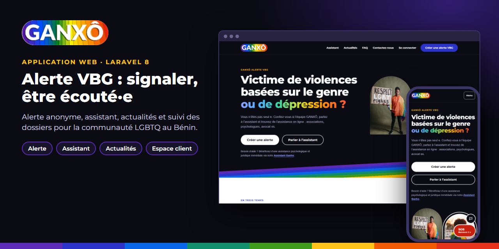

<p align="center"></p>

# GANXÔ · Alerte VBG

**Plateforme web d'alerte et de suivi des violences basées sur le genre (VBG)**, au service de la communauté LGBTQ au Bénin. Une personne peut signaler une situation, de façon anonyme si elle le souhaite, être écoutée et être orientée vers les bonnes personnes. L'équipe suit chaque dossier jusqu'à sa résolution.

En ligne : **[ganho.app](https://ganho.app)** · Un projet de l'association Bénin Synergies PLUS · BESYP (Abomey-Calavi, Bénin).

Le forum communautaire associé est dans le dépôt [ganhoforum](https://github.com/massenon/ganhoforum).

---

## Le projet

Les violences basées sur le genre restent souvent tues, faute d'un espace sûr et d'un interlocuteur de confiance. GANXÔ réunit au même endroit l'alerte, l'information fiable et le suivi des dossiers, avec une règle simple : **la sécurité et la confidentialité de la personne passent avant tout**.

L'application est née du gabarit de billetterie UHelp (Laravel 8). Elle a été reprise de bout en bout : design system Ganho, interface entièrement en français, accessibilité WCAG AA, SEO, navigation sans rechargement et assistant intégré.

## Fonctionnalités

### Site public
| | |
|---|---|
| **Alerte VBG** | Formulaire d'alerte avec ou sans compte, vérification par code, pièces jointes protégées, alerte anonyme possible |
| **Assistant** | Fenêtre de discussion basée sur une base de connaissances, qui peut aussi créer une alerte en conversation. Journaux anonymisés : le texte saisi n'est jamais conservé |
| **Actualités** | Articles avec chapô, sommaire, FAQ, méta-titre et méta-description, données structurées `NewsArticle`, `FAQPage` et `BreadcrumbList` |
| **Consultation** | Fenêtre de prise de contact avec un psychologue |
| **Pages légales** | Mentions légales, confidentialité, conditions et cookies, gérées depuis l'administration |
| **Navigation fluide** | Routeur SPA maison (`gn-spa.js`), transitions de page natives, désactivable par `GN_SPA=false` |
| **PWA** | Installable, page de repli hors ligne, service worker prudent (jamais sur l'administration ni les alertes) |
| **Accessibilité** | Cible WCAG AA, navigation au clavier, lecteurs d'écran, mode nuit |
| **SEO** | `robots.txt` et `sitemap.xml` dynamiques, balises Open Graph, JSON-LD, pages d'erreur sur mesure (400, 401, 403, 404, 405, 408, 410, 413, 419, 429, 500, 502, 503, 504) |

### Espace client
Tableau de bord, création d'alerte en trois étapes avec brouillon local, suivi par état (en attente, suivies, résolues), réponses, clôture, évaluation, notifications, profil et préférences. URL en français : `/espace-client/*`.

### Administration
| | |
|---|---|
| **Alertes et cas** | Liste, affectation, réponses, notes internes, pièces jointes, statuts et priorités |
| **Rapports** | Export Excel (`.xlsx`) et rapport statistique PDF des alertes, selon le périmètre de chaque rôle |
| **Recherche globale** | Recherche instantanée dans l'administration, limitée aux droits du rôle |
| **Rôles et permissions** | Droits par module, prestataires limités à leurs dossiers |
| **Contenus** | Actualités, FAQ, pages, base de connaissances de l'assistant |
| **Newsletter** | Abonnés, campagnes, test puis envoi par lots, désinscription |
| **Réglages** | Identité du site, messagerie, sécurité |

Toute l'administration est en français. URL : `/administration/*`.

## Sécurité et vie privée

- Pièces jointes d'alertes servies uniquement à leur propriétaire, au personnel habilité ou à l'invité vérifié pour cette alerte.
- Dépôts de fichiers filtrés par liste blanche d'extensions, noms assainis.
- Alerte anonyme : adresse technique `*.invalid`, aucun e-mail n'est jamais envoyé vers ce domaine.
- Liaison avec le forum signée par HMAC-SHA256 (`FORUM_ALERT_SECRET`).
- Limitation de débit sur l'assistant, la newsletter et les exports.
- Compression des réponses (Brotli ou gzip) et en-têtes de cache.

## Technologies

| Couche | Choix |
|---|---|
| Back-end | **Laravel 8**, PHP 7.3 à 8.1, MySQL |
| Modules | `nwidart/laravel-modules` (module `Uhelpupdate`) |
| Droits | `spatie/laravel-permission` |
| Exports | PhpSpreadsheet, dompdf |
| Front | Blade, CSS Ganho (jetons `--gn-*`), JavaScript sans framework, Laravel Mix |
| Hébergement | cPanel mutualisé |

## Installation en local

```bash
git clone https://github.com/massenon/ganhovbg.git
cd ganhovbg
composer install
cp .env.example .env
php artisan key:generate
# renseigner la base de données dans .env, puis :
php artisan migrate
php artisan serve
```

Variables propres au projet dans `.env` :

| Variable | Rôle |
|---|---|
| `APP_URL` | URL publique (`https://ganho.app` en production) |
| `FORUM_ALERT_SECRET` | Secret partagé avec le forum, 64 caractères hexadécimaux (`php -r "echo bin2hex(random_bytes(32));"`) |
| `GN_SPA` | `false` pour désactiver la navigation SPA |
| `GN_NEWSLETTER_MAX` | Plafond d'envois de newsletter par campagne |

> **Ne lancez jamais `migrate:fresh` sur une base réelle.** Les migrations s'exécutent une par une avec `php artisan migrate --path=…`.

## Jeux de données

Les seeders sont idempotents et peuvent être relancés :

```bash
php artisan db:seed --class=LegalPagesSeeder         # pages légales
php artisan db:seed --class=NewsPoolComSeeder        # actualités avec SEO
php artisan db:seed --class=AdminFrenchSeeder        # traductions de l'administration
php artisan db:seed --class=CustomerFrenchSeeder     # traductions de l'espace client
php artisan permission:cache-reset
```

`TestAccountsSeeder` crée des comptes de démonstration et refuse de s'exécuter si `APP_ENV=production`.

## Mise en production

La procédure complète (sauvegardes, fichiers, `.env`, migrations, seeders, caches, tâches planifiées, vérifications, retour arrière) est dans [`DEPLOIEMENT.md`](DEPLOIEMENT.md) du dossier de travail. En résumé, sur le serveur :

```bash
php artisan optimize:clear
php artisan config:cache && php artisan route:cache && php artisan view:cache && php artisan event:cache
```

Avec `APP_DEBUG=false` et HTTPS actif.

## Structure du dépôt

```
ganhovbg/
├── app/              Contrôleurs, modèles, services (assistant, rapports), middlewares
├── Modules/          Module Uhelpupdate
├── resources/views/  Vues Blade (public, espace client, administration, erreurs)
├── public/assets/ganho/   CSS et JavaScript du design system Ganho
├── database/         Migrations et seeders
├── routes/           Routes web, API (liaison forum) et installateur
├── tests/            Tests automatisés
└── outils/           Mesure de performance, purge CSS
```

## Licence

Voir le fichier [LICENSE](LICENSE).
